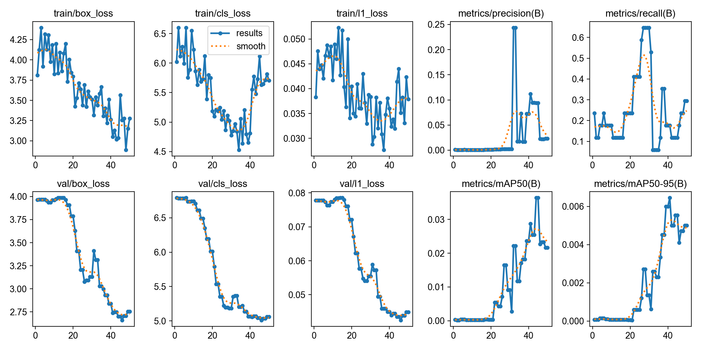

# YOLO26n entrenado desde cero: detección de matrículas

Entrenamiento **desde cero** (pesos aleatorios, sin preentrenar) de un detector
YOLO26n para una única clase, `plate`, con un subconjunto anotado a mano del
dataset *Car License Plate*.

Esta carpeta es autocontenida: código, dataset, arquitectura, parámetros,
pesos finales, registros y curvas de entrenamiento, y evaluación en test.

## Contenido

```
yolo_desde_cero/
├── README.md
├── pyproject.toml / poetry.lock  # dependencias (Poetry, Python 3.12, torch solo CPU)
├── poetry.toml               # el entorno virtual se crea en .venv/
├── Dockerfile / docker-compose.yml / .dockerignore
├── prepare_dataset.py        # preparación y validación del dataset
├── train.py                  # entrenamiento desde cero
├── evaluate_test.py          # selección del run en val + evaluación en test
├── utils/                    # dataset, inferencia, métricas, visualización, informe
├── model/
│   └── yolo26n.yaml          # arquitectura (copia de Ultralytics 8.4.172)
├── data/
│   ├── dataset.yaml          # configuración del dataset
│   ├── splits/{train,val,test}.txt   # lista de imágenes de cada partición
│   ├── images/{train,val,test}/
│   └── labels/{train,val,test}/      # anotación manual, formato YOLO
└── runs/
    ├── train/
    │   ├── img320/           # run seleccionado: weights/best.pt, results.csv, curvas
    │   └── img416/
    └── test/img320/          # predicciones, comparaciones y galería en test
```

## Dependencias

Resultados obtenidos en macOS, **CPU** (Apple M5). Las dependencias se
gestionan con Poetry (Python 3.12, `torch` solo CPU) y también se puede
ejecutar todo en Docker.

Principales: `ultralytics==8.4.172`, `torch==2.8.0`, `opencv-python==4.11.0.86`.
No hace falta descargar pesos: el modelo parte de una arquitectura vacía.

### Opción A: Poetry (local)

Requiere [Poetry](https://python-poetry.org/docs/#installation) ≥ 2.0 y Python 3.12.

```bash
poetry env use python3.12   # solo la primera vez, si python3.12 no es el predeterminado
poetry install              # crea .venv/ e instala las dependencias
```

### Opción B: Docker

Requiere Docker con Compose. `data/` y `runs/` se montan como volúmenes, así
que los resultados quedan en tu carpeta local. Dentro de Docker todo corre en
CPU.

```bash
docker compose build
```

## Ejecución

Desde esta carpeta:

```bash
poetry run python prepare_dataset.py   # 1. preparar y validar el dataset
poetry run python train.py --imgsz 320 # 2. entrenar (~2 min en CPU)
poetry run python train.py --imgsz 416
poetry run python evaluate_test.py     # 3. elegir el run por val y evaluar en test
```

Con Docker se sustituye `poetry run` por `docker compose run --rm app`, por
ejemplo:

```bash
docker compose run --rm app python train.py --imgsz 320
```

En Docker, `prepare_dataset.py` valida las imágenes ya copiadas en `data/images/`
(las originales de `../data/voc/images` no se montan).

---

## 1. Preparación de los datos

El dataset original tiene 433 imágenes (`Cars0.png` … `Cars432.png`) con
anotaciones VOC. Se usó un subconjunto de 55:

1. **Selección manual.** Se recorrieron las imágenes `Cars0`–`Cars81` en orden
   numérico y se descartaron las que no convencían. El reparto entre
   particiones también sigue ese orden, de modo que no se mezclan imágenes
   entre particiones.
2. **Anotación manual.** Las matrículas se anotaron a mano en formato YOLO
   (`clase cx cy w h`, normalizados), con una única clase `0: plate`. Las
   anotaciones VOC originales **no se usan**: las cajas se dibujaron de nuevo.
3. **Script** [`prepare_dataset.py`](prepare_dataset.py). Copia cada imagen
   original a su partición según las listas, comprueba que cada imagen tenga
   su etiqueta y que esta sea válida (5 columnas, clase 0, coordenadas en
   [0, 1], ninguna imagen en dos particiones) y genera `dataset.yaml`.

   Por defecto toma las originales de `../data/voc/images`; se puede indicar
   otra carpeta con `--source`. Si no las encuentra, valida las imágenes ya
   incluidas en `data/images/`. Con `--check` solo valida.

### Particiones

| Partición | Imágenes | Cajas | Rango | Lista |
|---|---|---|---|---|
| train | 35 | 39 | Cars0–Cars43 | [`data/splits/train.txt`](data/splits/train.txt) |
| val | 15 | 17 | Cars44–Cars68 | [`data/splits/val.txt`](data/splits/val.txt) |
| test | 5 | 7 | Cars70–Cars81 | [`data/splits/test.txt`](data/splits/test.txt) |

### Configuración del dataset

[`data/dataset.yaml`](data/dataset.yaml). No lleva `path`, así que Ultralytics
toma la carpeta del yaml como raíz y funciona en cualquier ubicación:

```yaml
train: images/train
val: images/val
test: images/test
names:
  0: plate
```

## 2. Entrenamiento

### Arquitectura

[`model/yolo26n.yaml`](model/yolo26n.yaml) es una copia sin cambios de la
definición YOLO26 de Ultralytics. El nombre del archivo selecciona la escala
`n` (depth 0.50, width 0.25), que da 2.5 M parámetros. Al pasar un `.yaml` en
lugar de un `.pt`, los pesos se inicializan aleatoriamente. Ultralytics
sustituye `nc: 80` por `nc: 1` a partir de `dataset.yaml`.

### Parámetros de entrenamiento

Están definidos en [`train.py`](train.py). La lista completa de cada run está en
su `runs/train/<run>/args.yaml`.

| Parámetro | Valor |
|---|---|
| Modelo | `model/yolo26n.yaml`, `pretrained=False` |
| `imgsz` | 320 y 416 (dos runs) |
| `epochs` | 50 |
| `batch` | 4 |
| `optimizer` | `auto` (Ultralytics elige según el número de iteraciones) |
| `lr0` / `lrf` | 0.01 / 0.01 |
| `momentum` / `weight_decay` | 0.937 / 0.0005 |
| `warmup_epochs` | 3 |
| Aumentos | mosaic 1.0 (se desactiva en las últimas 10 epochs), fliplr 0.5, hsv (0.015, 0.7, 0.4), translate 0.1, scale 0.5 |
| `patience` | 100 (sin parada temprana efectiva) |
| `seed` / `deterministic` | 42 / `True` |
| `device` | `cpu` |
| Versión | Ultralytics 8.4.172, PyTorch 2.8.0 |

### Pesos finales seleccionados

El run final se elige **solo con validación**: el de mayor mAP50-95 en val. Lo
hace `evaluate_test.py`. Dentro del run, `best.pt` es la epoch con mejor
*fitness* en val según Ultralytics.

| Run | Mejor epoch | val mAP50 | val mAP50-95 | |
|---|---|---|---|---|
| **img320** | 41 | 0.029 | 0.0065 | **seleccionado** |
| img416 | 49 | 0.012 | 0.0019 | |

**Pesos finales:** [`runs/train/img320/weights/best.pt`](runs/train/img320/weights/best.pt).

### Registros y curvas de entrenamiento

Cada run de `runs/train/<run>/` contiene:

- `results.csv`: registro por epoch con las pérdidas de train y val (box, cls,
  l1), precisión, recall, mAP50, mAP50-95 y learning rate.
- `results.png`: curvas de pérdidas y métricas a lo largo de las epochs.
- `BoxPR_curve.png`, `BoxF1_curve.png`, `BoxP_curve.png`, `BoxR_curve.png` y
  las matrices de confusión.
- `train_batch*.jpg` (lotes con los aumentos aplicados) y
  `val_batch*_{labels,pred}.jpg`.
- `args.yaml`: todos los parámetros del run.
- `train.log` (solo en entrenamientos nuevos): copia del log de consola. Los
  runs incluidos se entrenaron antes de añadirlo, así que su registro es
  `results.csv`.



## 3. Evaluación en test

`evaluate_test.py` aplica el `best.pt` seleccionado a las 5 imágenes de test,
con un umbral de confianza de 0.25 (el valor por defecto de Ultralytics,
fijado de antemano). Una predicción cuenta como acierto si tiene IoU ≥ 0.5 con
una caja anotada. En [`runs/test/img320/`](runs/test/img320/) guarda:

- `predictions.csv`: todas las cajas con confianza ≥ 0.01 y su puntuación,
  indicando si pasan el umbral y si son acierto o falso positivo.
- `predictions/labels/*.txt`: las cajas que pasan el umbral, en formato YOLO
  más la confianza.
- `comparisons/*.png`: imagen original sin marcas a la izquierda y la
  predicción a la derecha.
- `index.html`: galería; `summary.csv`: una fila por imagen; `metrics.json`.

| TP | FP | FN | Precisión | Recall | F1 | AP50 | mAP50 (Ultralytics) | mAP50-95 (Ultralytics) |
|---|---|---|---|---|---|---|---|---|
| 0 | 0 | 7 | 0.00 | 0.00 | 0.00 | 0.007 | 0.009 | 0.003 |

**Conclusión:** con 35 imágenes de entrenamiento y 50 epochs, el modelo desde
cero no llega a aprender la tarea. En val apenas pasa de 0.03 de mAP50, y en
test ninguna imagen tiene detecciones por encima de 0.25: las 7 matrículas
quedan sin detectar. Las pérdidas bajan poco en 50 epochs (val box loss de
3.97 a 2.75; cls loss de 6.79 a 5.06) y siguen siendo altas al final
(`results.png`). Una red sin preentrenar necesitaría bastantes más datos o
epochs para aprender a localizar matrículas.
